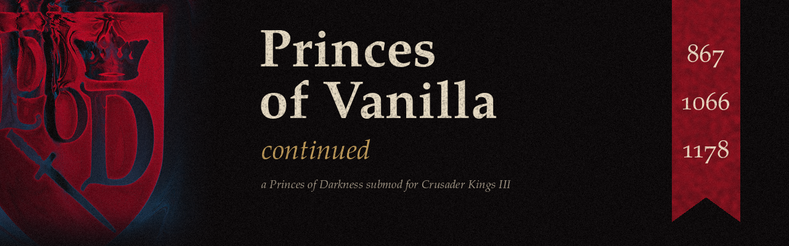

# Princes of Vanilla Continued

A Crusader Kings III submod for **Princes of Darkness**: play PoD on the vanilla bookmarks, **867**, **1066** and **1178**.

The original Princes of Vanilla was abandoned, so I picked it up, updated it for the current versions of the game and of PoD, and fixed a lot of bugs and crashes along the way.

**[Get it on the Steam Workshop](https://steamcommunity.com/sharedfiles/filedetails/?id=3834279660)**

## Compatibility

- Crusader Kings III 1.20.1.2 "Crozier" / By God Alone
- Princes of Darkness 1.20.1

## Load order

1. Princes of Darkness
2. Princes of Vanilla Continued

Don't use it with the older Princes of Vanilla submods.

## Game rules

**World of Darkness rule**

- *World of Darkness*: mortals can't hold titles and keep the Innocent faith.
- *World of Shadow*: mortals can hold titles and use vanilla faiths.
- *World of Corruption*: only mortals, hunters and supernatural servants exist (except for you).
- *World of Secrets*: everyone is mortal except you.

**Other rules**

- *Supernatural Dominance*: what the vanilla rulers become at game start.
- *Historical Demesne* (on by default): rulers keep their historical lands without domain penalties.
- *Mortal Rabble Size*: keep PoD's small levies, or get vanilla-sized armies.
- *Mortals Lifestyle XP boosts*: lifestyle XP closer to vanilla.

Tip: World of Secrets + Mortal: The Innocent gives you a vanilla-like world where you're the only creature.

## Screenshots

Coming soon.

<!-- Put screenshots in the images/ folder and add them here, for example:

-->

## Changes

See [CHANGELOG.md](CHANGELOG.md).

Found a crash? Open an issue here or leave a comment on the Workshop page.

## Credits

- 尽点, for the original Princes of Vanilla Bookmark
- Gold, for Princes of Vanilla Updated
- The Princes of Darkness team, for the mod this is built on

## Disclaimer

Free and unofficial fan mod. Not affiliated with Paradox Interactive.
